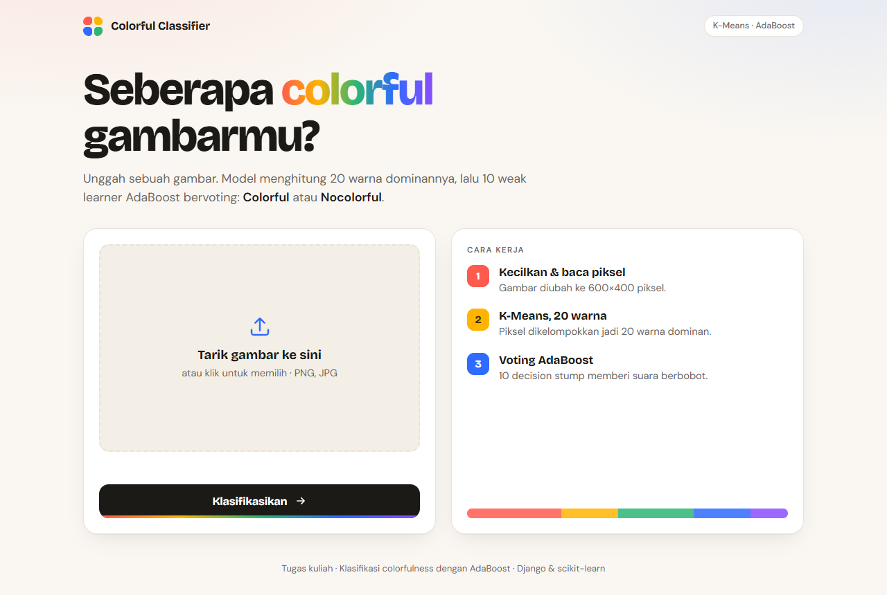
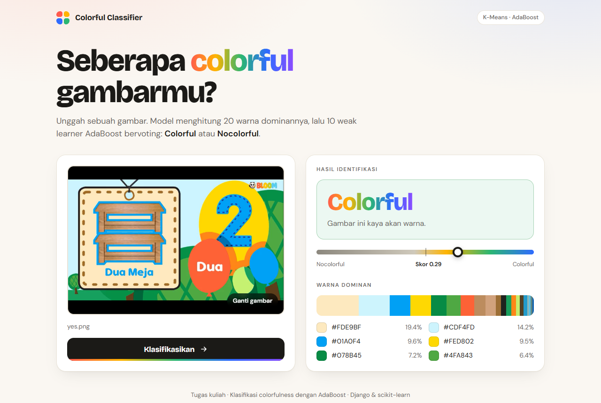
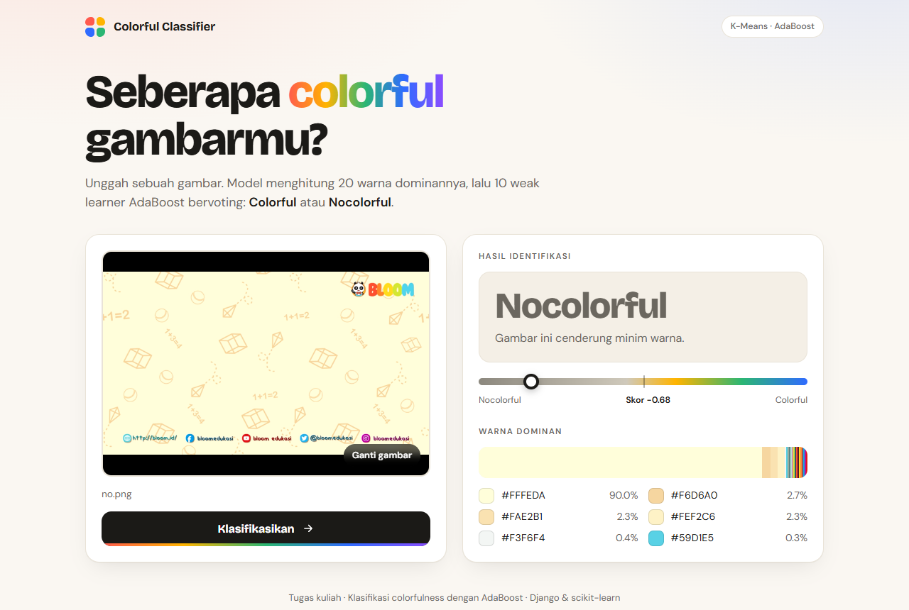
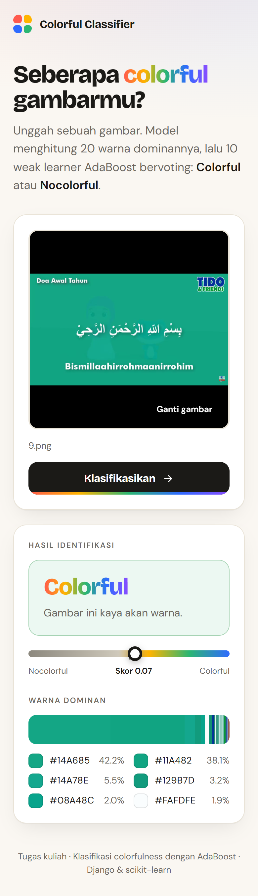
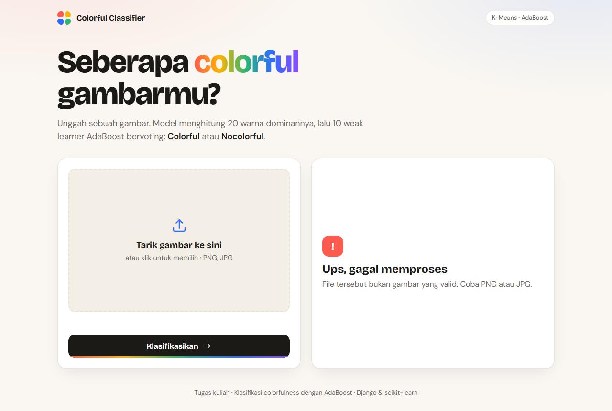

# 🎨 Colorful Image Classification — AdaBoost

Aplikasi web Django untuk mengklasifikasikan sebuah gambar sebagai **Colorful** (penuh warna) atau **Nocolorful** (kurang berwarna), menggunakan algoritma **AdaBoost** dengan *decision stump* sebagai weak learner. Project tugas kuliah (2021), dihidupkan kembali dan dibungkus Docker supaya mudah dijalankan lagi.

> UI-nya sengaja dibiarkan seperti aslinya: satu halaman, satu form upload, satu hasil.

## Screenshot

**Halaman utama** — dropzone drag-and-drop + penjelasan cara kerja:



**Hasil klasifikasi** — verdict, skor AdaBoost (−1…+1), dan palet warna dominan hasil K-Means:

| Colorful | Nocolorful |
|---|---|
|  |  |

**Mobile** (responsif) dan **penanganan error** (file bukan gambar):

<p>
  
  
</p>

Mendukung dark mode otomatis (mengikuti pengaturan OS).

Gambar contoh ada di folder [`media/`](media) (`yes.png` → Colorful, `no.png` → Nocolorful).

## Cara kerja

```
Upload gambar
   │
   ▼
Resize ke 600×400, konversi BGR → RGB                    (OpenCV)
   │
   ▼
K-Means, k = 20 warna dominan                            (scikit-learn)
   │
   ▼
Fitur = jumlah piksel di tiap cluster  → vektor 20 dimensi
   │
   ▼
AdaBoost, T = 10 weak learner (decision stump, max_depth=1)
   H(x) = sign( Σ αₜ · hₜ(x) )
   │
   ▼
> 0  → "Colorful"      ≤ 0 → "Nocolorful"
```

- Model weak learner: `static/ds_tree_0..9.pkl` (scikit-learn `DecisionTreeClassifier(max_depth=1)`).
- Bobot tiap weak learner (α): `static/bbt_pred.csv`.
- Seluruh logika inferensi ada di [`colorful_classification_app/views.py`](colorful_classification_app/views.py).
- Tidak ada training di repo ini — hanya inferensi dengan model yang sudah jadi.

## Quick start (Docker, direkomendasikan)

Butuh Docker + Docker Compose. Tidak perlu install Python apa pun.

```bash
git clone <url-repo-ini> colorful_classification_adaboost
cd colorful_classification_adaboost
docker compose up -d --build
```

Buka **http://localhost:8000** lalu upload gambar.

```bash
docker compose logs -f      # lihat log
docker compose down         # matikan
```

> ⏱️ Satu klasifikasi butuh ±10–20 detik di Docker Desktop (Windows) karena K-Means pada 240.000 piksel. Itu normal, bukan hang.

Deploy ke server/VPS: lihat **[DEPLOY.md](DEPLOY.md)**.

## Jalankan tanpa Docker

Versi library di `requirements.txt` sudah tua (2021) dan **harus Python 3.8 (maksimal 3.9)** — numpy 1.19, scikit-learn 0.24 (model `.pkl` dibuat dengan versi ini), opencv 4.5.1 tidak punya wheel untuk Python 3.10+.

```bash
python3.8 -m venv .venv
source .venv/bin/activate            # Windows: .venv\Scripts\activate
pip install -r requirements.txt
python manage.py runserver
```

Di Linux, OpenCV butuh `libgl1` dan `libglib2.0-0` (`sudo apt install libgl1 libglib2.0-0`).

## Konfigurasi (environment variable)

| Variable | Default | Keterangan |
|---|---|---|
| `DJANGO_DEBUG` | `True` (Docker compose: `False`) | Jangan `True` di production |
| `DJANGO_SECRET_KEY` | key dev bawaan | **Wajib diganti** di production |
| `DJANGO_ALLOWED_HOSTS` | `localhost,127.0.0.1,[::1],…herokuapp.com` | Pisahkan dengan koma |
| `DJANGO_CSRF_TRUSTED_ORIGINS` | kosong | Isi bila di belakang HTTPS reverse proxy |
| `DATABASE_URL` | SQLite `db.sqlite3` | Opsional; app ini tidak memakai tabel apa pun |

Contoh lengkap di [`.env.example`](.env.example).

## Struktur project

```
├── colorful_classification_adaboost/   # settings, urls, wsgi (project Django)
├── colorful_classification_app/        # view klasifikasi + template HTML
│   ├── views.py                        #   pipeline K-Means → AdaBoost
│   └── templates/template_image_processing.html
├── static/                             # model (.pkl), bobot (.csv), style.css
├── media/                              # gambar upload (+ contoh gambar)
├── docs/screenshots/                   # screenshot untuk README
├── Dockerfile  docker-compose.yml      # deployment
├── requirements.txt  Procfile  Aptfile # (sisa deploy Heroku lama)
├── README.md  DEPLOY.md
└── manage.py
```

## Perubahan dibanding versi 2021

Supaya bisa jalan lagi di lokal & VPS, ada beberapa perbaikan kecil:

- `settings.py`: `SECRET_KEY`, `DEBUG`, `ALLOWED_HOSTS` bisa diatur lewat environment; `ALLOWED_HOSTS` sebelumnya hanya berisi host Heroku sehingga `localhost` ditolak.
- `settings.py`: `STATIC_ROOT` dan `STATICFILES_STORAGE` yang rusak diperbaiki (`whitenoise.django` sudah tidak ada).
- `urls.py`: `/media/` sekarang selalu di-serve (dulu hanya saat `DEBUG=True`).
- `views.py`: bug nama file bentrok diperbaiki — upload file bernama sama (mis. `yes.png` dua kali) dulu mengklasifikasi file lama, sekarang memakai nama file yang benar-benar disimpan.
- **UI dirombak total** (`template_image_processing.html`, `static/style.css`): dropzone, pratinjau, loading state, skor + meter, palet warna dominan, responsif, dark mode. `views.py` kini juga mengembalikan palet & skor, dan upload non-gambar menampilkan pesan error (bukan 500).
- `Procfile`: path modul WSGI diperbaiki. `requirements.txt`: `psycopg2` → `psycopg2-binary` supaya build tidak butuh compiler.
- Ditambah `Dockerfile`, `docker-compose.yml`, `.dockerignore`, `.gitignore`, `.env.example`.

## Keterbatasan yang diketahui

- Hasil K-Means tidak deterministik (tanpa `random_state`) dan urutan cluster acak, jadi gambar yang "di perbatasan" bisa berganti label antar request.
- File upload menumpuk di `media/` tanpa pembersihan.
- Tidak ada test otomatis.

## Teknologi

Python 3.8 · Django 3.1 · scikit-learn 0.24 · OpenCV 4.5 · NumPy · Gunicorn · WhiteNoise · Docker
